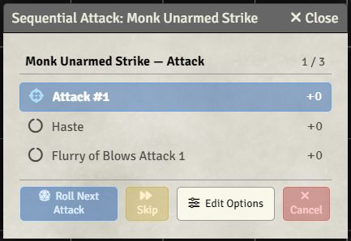

# PF1 Sequential Attacks 

A Foundry VTT module that allows full attacks to be resolved one attack at a time instead of all at once.

**Version:** 1.1.0  
**Foundry VTT Compatibility:** v13  
**Manifest URL:** `https://github.com/Hamilcarbarcas/pf1-sequential-attacks/releases/latest/download/module.json`

## Features



- **Sequential Attack Resolution**: Roll each attack in a full attack sequence individually
- **Visual Tracker**: Dialog displays all attacks in the sequence with status indicators:
  - Current attack
  - Completed attacks
  - Skipped attacks
  - Pending attacks
- **Per-Attack Control**: 
  - Roll attacks one at a time using the "Roll Next Attack" button
  - Skip individual attacks without rolling them
  - Retarget between attacks
  - Toggle buffs/debuffs between attacks
- **Roll All Remaining**: Roll every remaining (unresolved) attack at once in a single chat card — the same as the system's default full-attack behaviour — to quickly finish out a sequence you no longer need per-attack control over
- **Several Actions, One Sequence**: Add more attacks to an open tracker (claw, claw, bite) and resolve them in any order, while each action's own attacks keep their order
- **Attack Routines**: Save a set of attacks as a named routine on the combat tab, with preset options per attack, and start them all as one sequence from the sheet, the token HUD, or a hotbar macro
- **Attack Bonus Preview**: See the calculated attack bonus for each attack before rolling
- **Progress Tracking**: Dialog shows current attack count
- **Individual Chat Cards**: Each attack posts its own chat message when resolved
- **Theming**: The tracker uses an amber-on-dark theme by default; a per-client **Use Legacy Theme** setting restores the original blue/green/gold colour scheme

## Usage

### The Sequential Attacks setting
Each player picks a mode under **Sequential Attacks** in the module settings. The choice is saved per user, so it follows them to any browser.

- **Always (default)** — the attack dialog gains a **Sequential attack** checkbox, ticked for full attacks or when a tracker is already open, unticked otherwise.
- **Ask** — the same checkbox, always unticked unless a tracker is already open.
- **Off** — the module stays out of the way entirely.

Quick rolls (no dialog) can't show the checkbox, so they follow a fixed rule: a full attack starts a sequence under **Always**, and joins an open one under either mode. A quick-rolled single attack always resolves normally, so an attack of opportunity never ends up inside a sequence. A quick-rolled weapon counts as a full attack, so roll an iterative-weapon attack of opportunity through the dialog's **Single Attack** button.

### Appearance
The tracker window ships with two colour schemes, chosen per client under **Use Legacy Theme**:

- **Off (default)** — amber accent on dark panels, matching this author's other PF1 modules.
- **On** — the module's original scheme: blue current attack, green resolved, gold skipped, tinted buttons.

This setting affects appearance only. Note that the default theme states its own colours rather than following Foundry's light/dark theme, so it stays dark regardless of your client theme.

### During an Attack
When you have multiple attacks in a full attack sequence and sequential mode is enabled:
1. The attack dialog appears as normal, with the **Sequential attack** checkbox above its buttons
2. After confirming the dialog with the box ticked, a sequential tracker shows all your attacks
3. Click **"Roll Next Attack"** to roll the current attack and post it to chat
4. **"Skip"** an attack if you don't want to roll it
5. **"Roll All Remaining (N) as one card"** to roll every remaining attack together in a single chat card (vanilla full-attack behaviour); shown whenever two or more attacks are left. Note: this snapshots actor state once, so buffs toggled *between* the batched attacks are not applied individually.
6. **"Cancel"** to abort the entire sequence

The tracker will auto-close when all attacks are resolved.

### Combining several actions
With a tracker open, use another attack from the same actor (or token, for unlinked tokens). Its dialog's checkbox reads **Add to sequential attack** and starts ticked; confirm and the action joins the tracker. Untick it for an attack that isn't part of the full attack, such as an attack of opportunity.

Once a tracker holds more than one action, each gets its own header:

- **Roll** (die icon) rolls that action's next attack. Each action's attacks still go in their own order, but you can switch between actions freely: claw, bite, claw.
- **Roll Next Attack** continues with whichever action you rolled last, moving on when it runs out.
- **Edit options** (sliders icon) reopens that action's attack options.
- **Remove** (×) drops an action that hasn't rolled anything yet. Nothing it would have spent is spent.
- **Roll All Remaining** posts one card per action.

Each action spends its own charges or spell slot and runs its own script calls. Haste and Rapid Shot can be ticked on more than one action. You'll get a warning when that happens, but it isn't blocked.

### Attack Routines
A routine is a saved set of attacks that starts as one sequence. Routines live in their own category at the top of the combat tab.

- **+** in the category header adds an empty routine. The edit icon on its row opens the routine's own sheet, laid out like an item sheet: click the image to change it, type a new name, set **Quickbar** and **Quick roll** in the sidebar, and write a description. The trash icon deletes the routine.
- **Drag an attack** from the same sheet onto a routine to add it. Drag attacks within a routine to reorder them; that order is the order **Roll Next Attack** follows. Only items already on the actor can be added.
- The rows under a routine are **shortcuts** to the real items. Removing one (the unlink icon) never touches the item itself.
- **Click a routine's name** to collapse or expand it.
- **The die icon** on the routine row uses it.

**Presets.** The sliders icon on an attack opens its real attack dialog, after the action picker for an item with more than one action. Choose options and confirm: nothing is rolled or spent, and the choices are saved for that attack. A set preset shows its icon highlighted. The action you picked becomes the one a quick roll uses. Per-attack ammunition isn't saved; the item's default ammo is used. Any script that runs *before* the attack dialog (such as a Pre-Activate script call) still runs while you edit a preset.

**Using a routine.**
- **Quick roll** ticked: every attack uses its saved action and preset with no dialogs.
- Not ticked: every dialog appears as normal, the action picker included, already filled in from the presets.
- **Shift** inverts the choice for that one use.

**Quickbar** ticked shows the routine with the actor's quick actions, both on the sheet and on the token HUD. Click uses it; right-click opens the actor's combat tab. **Drag a routine row to the hotbar** for a macro that uses it on whichever token is selected, so one macro serves every token of an NPC.

For unlinked NPC tokens, build routines on the actor in the sidebar; a routine edited on a single token's own sheet stays with that token.

### Per-attack scripts and animations

Install **pf1-new-script-hooks** (v1.6.0 or later) and its **Per Use** script call category fires
once for each attack in the sequence, as that attack's card is built. `shared.targets` has already
been refreshed by then, so it holds the target *that* attack is aimed at — which is what a
per-projectile Sequencer/JB2A effect needs:

```js
// Per Use script call on the action
new Sequence()
  .effect()
    .file("jb2a.chain_lightning.primary.blue")
    .atLocation(token)
    .stretchTo(shared.targets[0])
  .play();
```

The same script also works with sequential mode off — the category fires once per row of the
single card instead — so nothing has to know which mode is in use. Without that module installed,
nothing happens and no script runs.

### Actions that roll no attack

Normally these have nothing to sequence: one use, one card, and the module hands straight off to
the usual flow. If another module gives such an action more than one entry — repeated uses of a
multi-projectile spell like magic missile, which rolls no attack — the tracker walks those uses
one at a time just as it does a full attack, so you can retarget between them. No attack roll is
made for them, and the bonus column stays blank.

### For module developers

In sequential mode, `pf1PostActionUse` fires only once per action, when the tracker closes. It
passes that action's **last** card, and by then `shared.attacks` is the action's whole attack list
again. Code that needs every card should also listen to this hook:

```js
Hooks.on("pf1SequentialAttacks.postCard", (actionUse, message) => { /* ... */ });
```

It fires after each card posts, whether the card holds one attack or a Roll All Remaining batch.
While it runs, `shared.attacks` holds just that card's attacks, in the card's order, so index `i`
is row `i` of the card's `system.rolls.attacks`. `message` is `null` if the card was hidden. To
avoid handling the same attacks twice, skip the final `pf1PostActionUse` when
`shared.sequentialAttack` is set.

Sequential mode rebuilds `shared.rollData` before the attack dialog, before each attack, and
before Edit Options, which drops anything stamped onto it at `pf1CreateActionUse`. To stamp it
again:

```js
Hooks.on("pf1SequentialAttacks.refreshRollData", (actionUse) => { /* ... */ });
```

To start several of one attacker's actions as a single sequence from code:

```js
const { result, dropped } = await game.modules.get("pf1-sequential-attacks").api.startSequence(
  token,                                          // Token, TokenDocument, Actor, or a uuid
  [{ item: clawId, action: actionId }, biteItem], // Item documents, ids, or uuids; action optional
  { skipDialog: false }                           // true quick-rolls every entry
);
```

Entries are used one after another through the normal `item.use()`, each with its own attack
dialog unless `skipDialog` is set, and the tracker opens once all of them have been tried. If the
attacker already has a tracker open, the entries join it. An entry that can't join (wrong actor,
missing item, failed requirements) is left out with a warning; a cancelled dialog is left out
quietly. Either way it spends nothing. The promise settles when the sequence ends: `result` is
`"completed"`, `"cancelled"`, or `"empty"` if nothing joined, and `dropped` lists each left-out
entry with its reason.

Each entry may also carry `presets`, keyed by action id, holding attack-dialog form values to
apply when that action is used. To use a saved Attack Routine instead:

```js
game.modules.get("pf1-sequential-attacks").api.useRoutine(routineId, { subject: token });
```

While an attack resolves, `shared.sequentialAttack` describes where it sits. `index`, `total`,
`isFirst` and `isLast` count within its own action. `blockIndex` and `blockCount` place the action
in the sequence, and `isFirstInSequence` is true only for the first attack of the whole sequence.

## Compatibility

- **Minimum Foundry Version**: 13
- **Verified Version**: 13
- **Required Dependencies**:
  - **libWrapper** (https://github.com/ruipin/fvtt-lib-wrapper)
  - **Pathfinder 1e** system
- **Optional**:
  - **pf1-new-script-hooks** v1.6.0+ — enables the per-attack **Per Use** script call category described above.
